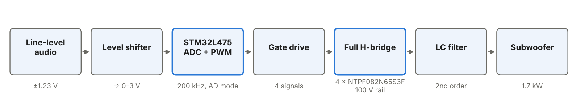
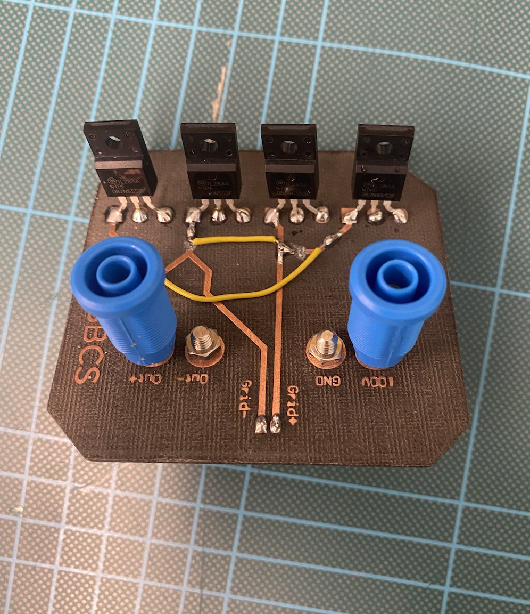
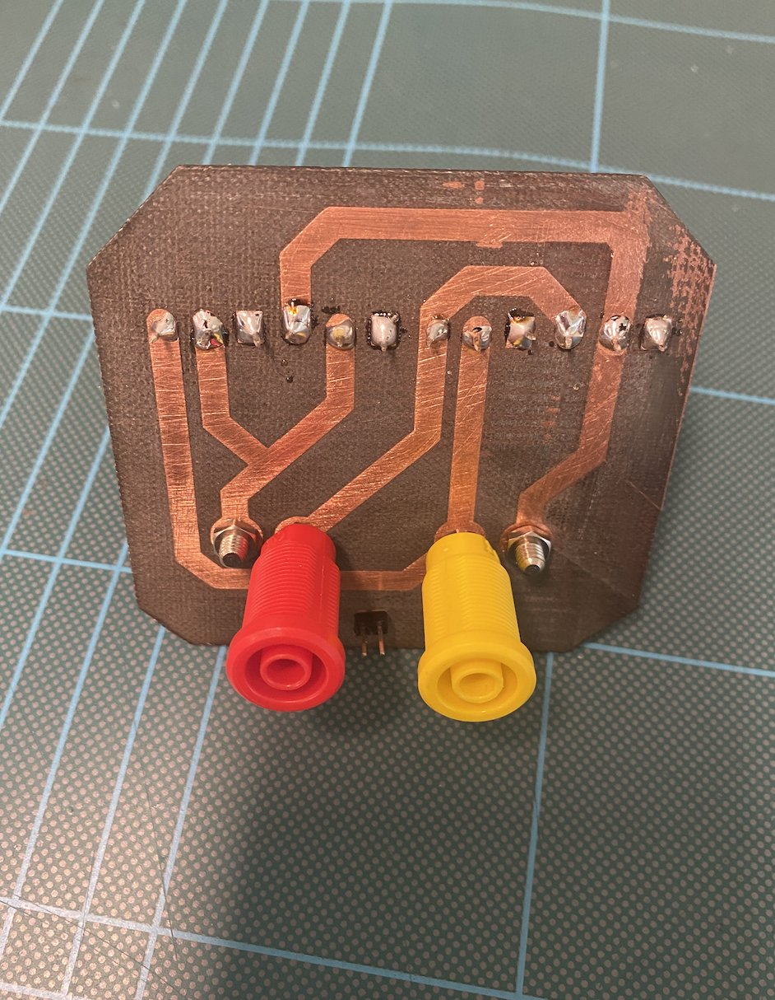
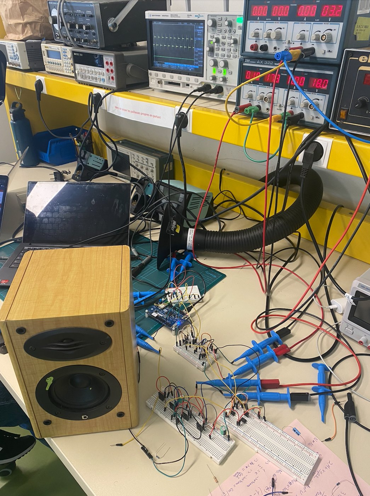
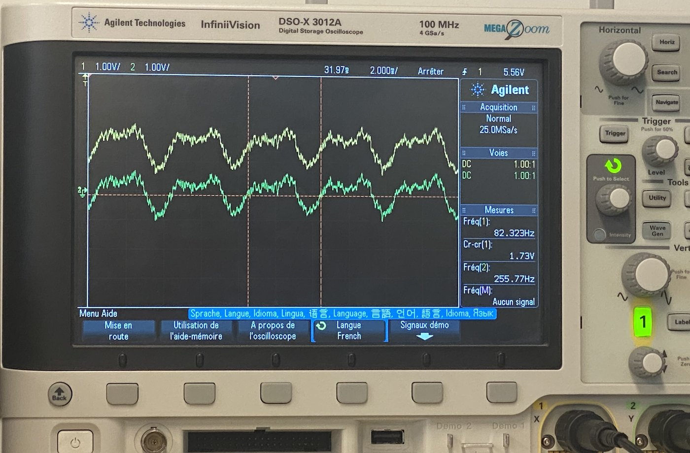
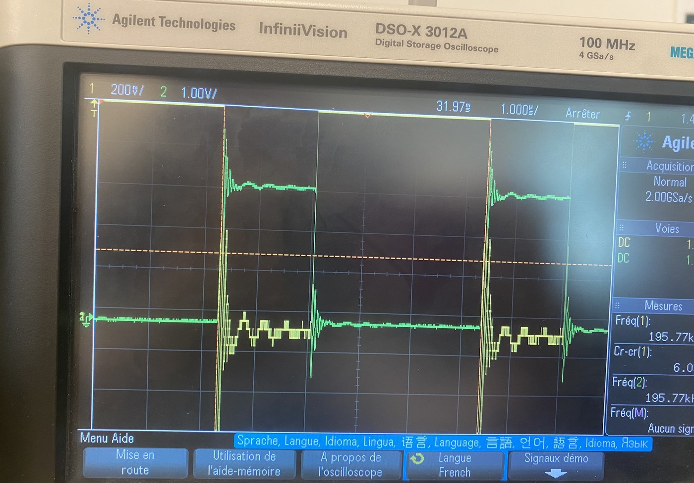
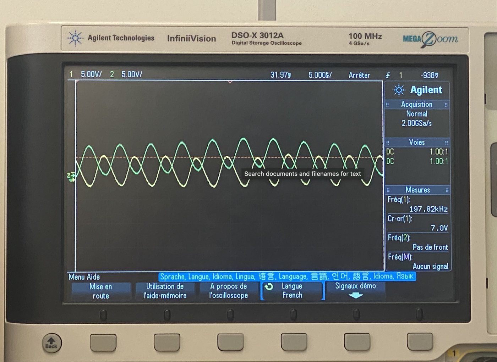
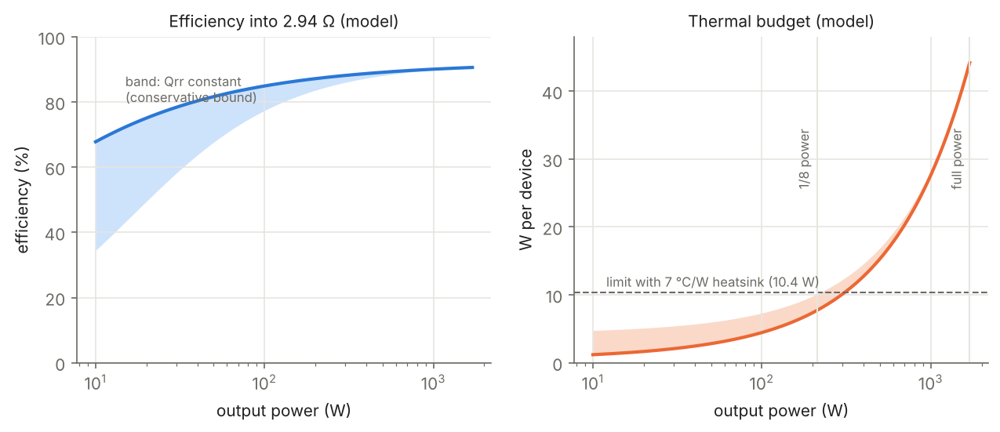
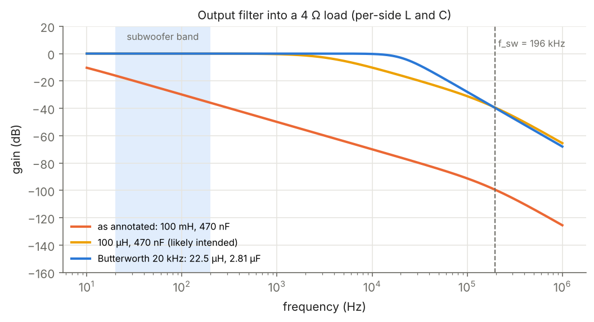
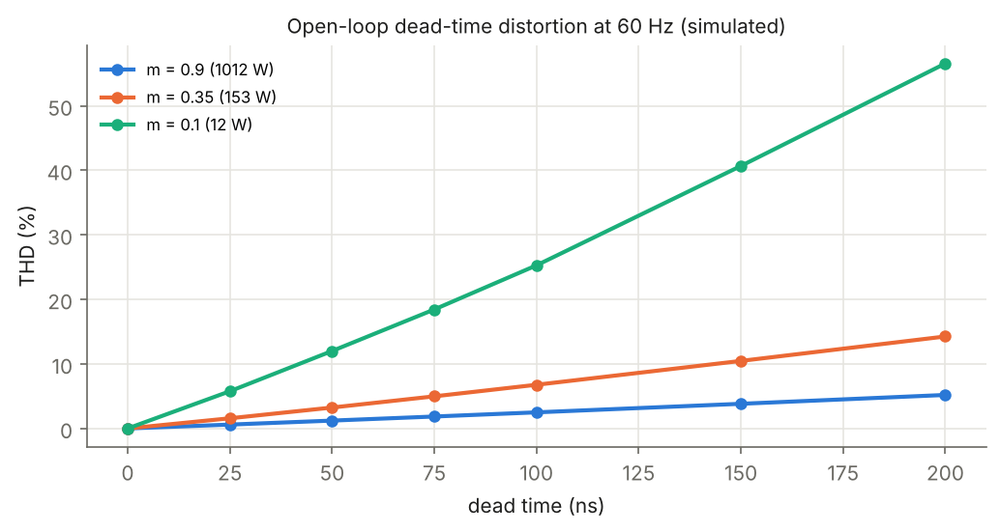

# Class-D amplifier for a 1.7 kW subwoofer

This is a full-bridge class-D amplifier built to drive a 1.7 kW passive subwoofer. An STM32L475 samples the line-level input and generates 200 kHz PWM, which switches four 650 V MOSFETs on a custom milled H-bridge board. The repository contains:
- the bench prototype;
- a datasheet-based design analysis of the full-power stage;
- redesigned, unit-tested firmware;
- a characterisation protocol for the full-power build.

The full write-up is [`docs/report.pdf`](docs/report.pdf).

<p align="center"></p>

| Status | What |
|---|---|
| **Measured** | Level-shifted audio inside the ADC range. PWM at 195.8 kHz. Antiphase pre-amplifier outputs. Audio reproduced through a small loudspeaker at reduced rail voltage. |
| **Modelled** | Deliverable power vs load. Losses, efficiency and thermal budget. Gate-drive timing. Output-filter response. |
| **Simulated** | Open-loop dead-time distortion. Noise-shaped modulator resolution. |
| **To measure** | Power, efficiency, THD+N, PSRR and thermal steady state, following [`docs/test-protocol.md`](docs/test-protocol.md). |

## Prototype

<p align="center">



</p>
<p align="center">



</p>

The level shifter, pre-amplifier and gate-drive stages are on breadboard, and the H-bridge is on a milled single-sided PCB. The complete chain played audio at reduced rail voltage; the loudspeaker's own inductance acted as the output filter. The schematic of the power stage is [`hardware/power_stage_schematic.jpg`](hardware/power_stage_schematic.jpg).

## Design analysis: what full power requires

**1. Load impedance sets the power.** A full bridge delivers at most P = V²/2R. On a 100 V rail, 1.7 kW is reachable only if the subwoofer's minimum impedance is at most 2.94 Ω. Into 4 Ω the limit is 1250 W, and into 8 Ω it is 625 W.

**2. The efficiency target holds; continuous full power does not.** The modelled efficiency at rated power is 90.6%. Conduction loss dominates, and it puts 44 W in each device, more than a TO-220 FullPAK can shed through its 2.62 °C/W junction-to-case resistance. At 1/8 power, the usual music-power rating, the 7 °C/W heatsinks are adequate: 7.7–10.1 W per device against 10.4 W allowed.

<p align="center"></p>

**3. Gate drive is the first fix.** A 70 nC gate charged by an op-amp at about 20 mA takes 3.5 µs, longer than the 2.5 µs half-period. High-side N-MOSFETs also need a gate voltage above the rail. Both problems call for a bootstrap half-bridge driver.

**4. The output filter's annotated values would block the bass.** With 100 mH and 470 nF per side, the filter attenuates 50 Hz by 24 dB into 4 Ω. The values were most likely meant as µH. A 20 kHz Butterworth design (22.5 µH, 2.81 µF) is flat over 20–200 Hz and attenuates the carrier by 40 dB.

**5. Dead time is costly at 200 kHz.** In open loop, dead time adds an error of 2·V_bus·f_sw·t_dead, which is 5.9% of the rail at 150 ns. The simulated result is about 10% THD at 153 W, and far more at low level. This makes the case for minimal dead time and closed-loop feedback.

<p align="center">


</p>

## Firmware

[`firmware/`](firmware) is a register-level redesign for the B-L475E-IOT01A board. It builds to 1.5 kB:

- **Gate timing:** TIM2 runs in centre-aligned mode at 200 kHz, and its four channels drive the four gates (Arduino pins D1, D0, D10, D4). The high- and low-side compare values are placed ±6 counts around each switching point, which gives a 150 ns hardware dead time on every edge. Every switch keeps a minimum on-time for bootstrap refresh.
- **Synchronised sampling:** the ADC is triggered by the PWM timer at 400 kS/s. The duty cycle is updated in the conversion interrupt through preloaded registers.
- **DC tracking:** about 1 Hz, so the level-shifter offset needs no calibration.
- **Noise shaping:** first-order error feedback raises the in-band (20–200 Hz) SNR of the 7.6-bit PWM from 65.8 dB to 98.8 dB.
- **Soft start:** the gates are held low, then released at 50% duty, which puts 0 V on the load.

Host-side unit tests check the dead time and minimum on-time on every sample over 10⁶ random inputs, plus the gain of a test tone. **The firmware has not yet been validated on hardware.**

```bash
make -C firmware          # arm-none-eabi-gcc -> firmware/build/classd_amp.bin
make -C firmware test     # host-side modulator tests
make -C firmware flash    # st-flash, board connected over ST-LINK
```

## Analysis and measurement tools

```bash
pip install -r requirements.txt
python analysis/power_stage.py      # power vs load, loss breakdown, heatsink check
python analysis/make_figures.py     # all figures in figures/
python analysis/thd_from_capture.py capture.csv --f0 60 --load 4   # THD+N and power from a scope/sound-card capture
```

## Repository layout

```
analysis/     power_stage.py (loss and thermal model), pwm_sim.py (filter, dead time),
              thd_from_capture.py (measurement helper), make_figures.py, block_diagram.py
docs/         report.pdf / report.tex, test-protocol.md
firmware/     src/ (main.c, modulator.c, amp_config.h), test/, Makefile, CMSIS headers
hardware/     power-stage schematic
photos/       prototype and oscilloscope captures
figures/      generated plots
```

## Next steps

1. Fit a bootstrap half-bridge gate driver.
2. Replace the MOSFETs with devices rated for the 100 V rail rather than 650 V.
3. Use a correctly dimensioned LC filter.
4. Move to a two-layer PCB with a tight switching loop.
5. Add closed-loop feedback.
6. Run the characterisation protocol.

— Minka Dubourg
